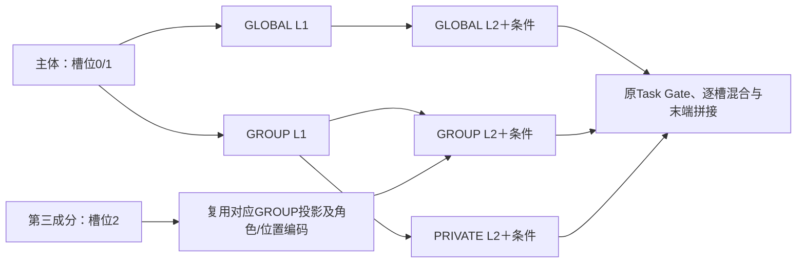

# ADR-0125：第三成分仅在GROUP L2接入的独立试验

## 状态与范围

已接受（2026-11-11，用户明确指定“只在GROUP L2再接入”）。扩展[ADR-0120](0120-entity-token-attention-late-fusion.md)的独立可选路径；现有Base、现役消融及已完成的token_attention结果保留原合同。本次只交付实现、完整配置和临时小数据验证，不启动正式训练或测试。

## 问题

本轮solvation与transfer_organic五折验证弱于历史配方，但Stage1、容量和数据也发生变化，尚不能归因于注意力。该试验固定当前Stage1、22项实验、两项模拟辅助、G2_C01容量、007/032预算及seed，只检验第三成分的接入范围；不承诺验证指标改善。

## 决定

显式设置`model.partner_injection: group_l2`；Stage2对应`home.model.partner_injection`。默认`l1`沿用原行为并从序列化中省略，保留既有配置身份、参数初始化和预测；MLP拒绝此新模式。

- 三槽顺序仍为IL＋溶质的`[阳离子,阴离子,溶质]`，有机溶剂体系的`[溶剂,空,溶质]`。这里的“第三成分”指槽位2，不直接按原始primary/partner列名判断。
- GLOBAL/GROUP L1只编码槽位0/1，路由输入的第三成分特征、角色和有效位均置零；GROUP归一化后再次清除屏蔽槽位，避免LayerNorm偏置泄漏。
- GLOBAL与PRIVATE L2只处理主体及物理条件。GROUP L2的每个专家在此时才加入第三成分：复用同序GROUP L1专家的输入投影、角色/位置编码及GROUP归一化，不经过第三成分的L1注意力。没有新增可训练参数，参数形状、数量及初始化与对照一致。
- PRIVATE L2继续与GROUP L2并行、读取GROUP L1；第三成分通过GROUP候选影响最终预测。Task Gate保持原宽度和算法，读取主体结构与原三槽mask；它知道第三成分是否存在，不直接读取其结构。最终三槽拼接和条件还原不变。
- Stage1永久冻结；owner归属、真实batch加权、模拟隔离、LR、寿命、采样、loss和末轮发布均不变。复用的投影仍属于原GROUP owner，随其冻结。

## 身份与运行

配置字段和解析后的注意力合同同时进入Stage2/3训练及产物身份。即使参数形状相同，也禁止两种模式交叉恢复、迁移或改名复用；Stage2与Stage3必须使用匹配模式并重新训练。

完整配置为`configs/v4/stage2/group_l2_partner.yaml`及`configs/v4/stage3/group_l2_partner.yaml`。沿用当前Base的Stage1与身份匹配的token_attention prepare，后者只读复用，不改metadata或SHA。Stage3引用新试验的Stage2 final。新训练写入`outputs/v4/stage{2,3}/group_l2_partner/train/`，原Base YAML与结果不覆盖。命令见[v4手册](../v4-runbook.md#group-l2-partner)。

## 取舍与验证

该路径将第三成分依赖集中到GROUP分支，GLOBAL/PRIVATE候选不能直接适配其结构；固定参数量能减少比较混杂，但不等同于固定计算量或保证性能提高。重新训练配对Stage2/3有额外成本，Stage1与冻结表示无需重算。

临时数据检查IL＋溶质与溶质＋溶剂的接入位置、扰动/梯度隔离、缺席槽位及归一化偏置屏蔽；新旧模式参数初始化一致、原模式预测逐bit不变。复用现有端到端测试覆盖准备、五模拟训练、完整final、严格迁移/恢复、Stage3三阶段/冻结、模拟预测及评估；不同模式拒载，prepare身份可复用。正式比较仍使用完整22任务五折验证，测试集不驱动选择。
