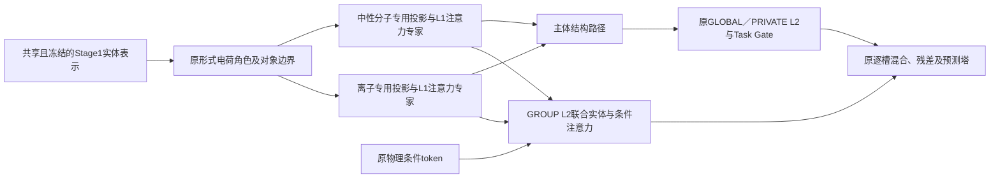

# ADR-0127：第三成分注入路径与离子／中性分子独立编码消融设计

## 状态与范围

已接受并实现（2026-11-11，用户要求执行方案）；S1采用独立的下游投影与注意力专家，在GROUP L2联合交互，Stage1保持共享冻结。本次交付实现、配对YAML及临时小数据验收；正式训练由用户启动，命令见[运行手册](../partner-injection-ablation-runbook.md)。

2026-11-13按用户补充增加I5：第三成分仅进入PRIVATE L2，沿用I2的投影及汇聚规则，关闭GROUP L2的第三成分输入；原有编号、配置及产物不变。

这是[ADR-0125](0125-group-l2-partner-injection.md)之外的独立研究套件，不改正式Base，不扩充或重编号[ADR-0124](0124-current-token-home-ablations.md)的C0～C10／E1～E5，不恢复HPO、容量搜索或追加训练seed。现有配置、来源、模型和结果保留原身份。

## 问题与可检验目标

原token模型的L1已将主体与第三成分分别编码，首次跨对象注意力也是在L2。因此，原模型与GROUP L2方案的差异不只是“交互更晚”：还包括第三成分是否经过L1编码、哪些L2分支能读取它，以及是否通过Task Gate结构输入和末端残差影响预测。两套结果的差值不能单独证明注入时机的因果作用。

本设计分别检验三个问题：

1. GROUP之外的PRIVATE、GLOBAL直接读取第三成分，以及仅PRIVATE而不让GROUP接收，是否有利于完整22任务验证？
2. 接入范围固定为GROUP L2时，第三成分是否需要独立的L1注意力编码？
3. 编码深度与接入位置相同时，离子与中性分子不共享下游编码参数是否有利？

## 共同合同

共享当前Stage1 encoder及匹配的learned1024＋RDKit211实体缓存；不重训Stage1，不改变其输入。固定data/3407、完整22实验与两模拟辅助、训练seed42及Stage3原有折派生规则、G2_C01的L2专家数量和007/032预算。保持条件编码、三槽顺序、1024D／8头／2层、目标scaler、loss、采样、逻辑batch／microbatch、owner样本加权梯度、学习率、冻结日历、三阶段末轮发布及模拟隔离。

三槽仍为IL体系的`[阳离子,阴离子,空]`、IL＋溶质的`[阳离子,阴离子,溶质]`、有机体系的`[溶剂,空,溶质]`，单分子为`[分子,空,空]`。第三槽不是中性分子的同义词。

## 第一组：接入范围与独立编码

| 编号 | 第三成分在接入前的处理 | 直接读取第三成分的L2分支 | 状态与参照 |
|---|---|---|---|
| I0 | 原L1独立编码及原路由 | GLOBAL、GROUP、PRIVATE | 已有token_attention模型，只作完整方案参照 |
| I1 | 原GROUP输入投影、角色／位置编码及归一化 | GROUP | 已有group_l2_partner模型，受控比较的基准 |
| I2 | 同I1；按下面固定规则增加PRIVATE输入 | GROUP、PRIVATE | 已实现；与I1比较PRIVATE直接访问的作用 |
| I3 | 同I2；按下面固定规则增加GLOBAL输入 | GLOBAL、GROUP、PRIVATE | 已实现；与I2比较GLOBAL直接访问的作用 |
| I4 | 同I1，但第三成分再经过对应GROUP专家的独立L1注意力编码 | GROUP | 已实现；与I1比较第三成分独立编码的作用 |
| I5 | 同I2的PRIVATE投影及主体GROUP路由加权汇聚，不经过第三成分L1注意力 | PRIVATE | 与I2比较GROUP直接访问的作用，与I1比较仅PRIVATE／仅GROUP接入 |

I1～I5的主体L1、L1主体路由、Task Gate结构输入及末端主体残差均不读取第三成分；Task Gate继续保留原三槽有效位。第三成分只通过指定L2候选进入末端混合，候选数量及flat门控算法不变。PRIVATE仍与GROUP L2并行，不改成读取GROUP L2输出的串行网络。

新增输入不另建投影或路由网络：

- GROUP继续按L2专家索引读取同索引GROUP L1专家的第三成分投影／角色／位置编码，再用原GROUP归一化，与I1一致。
- I2／I3的PRIVATE读取上述GROUP第三成分表示的加权和，权重固定使用当前样本的主体GROUP L1路由权重；不按PRIVATE专家数量重新配对，不让第三成分改变该路由。此汇聚规则在I2／I3完全一致。
- I3的GLOBAL按索引读取对应GLOBAL L1专家的第三成分投影／角色／位置编码；不增加GROUP到GLOBAL的参数依赖或新的归一化层。
- I4在GROUP每个专家内部，对第三成分单独执行其已有的两层TokenStack，再经过原GROUP归一化。主体与第三成分在GROUP L2之前仍不相互注意。编码后的第三槽不回填到主体结构、gate或残差。
- I5的GLOBAL／GROUP L2仅接收主体及条件；PRIVATE读取与I2完全相同的第三成分投影、归一化及主体GROUP路由加权和。投影、归一化和路由仍归属原GROUP owner，Phase3随GROUP冻结；“仅PRIVATE注入”描述L2接收分支，不表示第三成分的全部上游参数都属于PRIVATE。没有新增投影、路由或可训练参数。

I1～I5保留相同参数集合，并按owner配对初始化；计算量、梯度和Dropout随机轨迹不要求相同。I0与I3也存在路由、残差及编码差异，不能将其差值称为纯注入时机消融。

## 第二组：独立的离子与中性分子专家S1

S1以I4为配对对照，接入位置固定为GROUP L2。不能只与I1比较后将全部收益解释为参数分离，因为I1没有第三成分的L1注意力编码。

图中主体结构路径只接受原槽位0／1；第三槽无论带电与否都只能流向GROUP L2，不进入GLOBAL／PRIVATE、gate结构输入或主体残差。

### 分流与交互

- 按现有实体形式电荷角色分流：cation／anion使用离子专家，neutral使用中性分子专家；不根据任务名、槽位编号或目标值推断。IL的阳／阴离子仍作为同一对象，在离子分支内相互注意。
- 中性溶剂、溶质和hydration单分子使用同一套中性分子专家。它们作为不同对象分别编码；有机溶剂与溶质不能因为类型相同而在L1提前交互。
- 单独带电的溶质仍走离子专家，但保持单分子对象边界，不能与IL离子在L1拼成一个对象。角色one-hot、位置、mask和来源不改。
- GLOBAL与每个GROUP各自拥有两套独立的L1输入投影、角色／位置编码及注意力专家，沿用本owner原专家数作为每种类型的数量。不同owner不共享参数；本轮不再拆阳离子／阴离子、不增加第三类可学习路由。
- GROUP L2融合两类表示及原物理条件，保留三实体token。GLOBAL／PRIVATE L2、条件编码器、Task Gate和预测塔保持I4结构；本轮不复制整个下游网络，也不新增融合层。

### 初始化、owner与容量

I4每个L1专家的随机初始化用于S1对应的离子／中性两份独立参数副本，复制发生在Stage2训练之前；两份参数不绑定，不从已有训练后模型复制权重。这样减少随机初值差异，但不会改变S1需要独立训练的事实。

两类专家均归属原GLOBAL或对应GROUP owner，使用其原LR、样本加权分母、调度器和冻结时刻；不设新的类型owner或分支预算，不按类型重新归一化共享梯度。Stage2保持原五任务联合训练，分支仅从实际参与的输入取得梯度；Stage3在GLOBAL／GROUP冻结后，其下属两类专家一起冻结，Phase3仍只更新原PRIVATE参数。

Stage2按owner和实际实体类型报告样本覆盖与更新情况。其solvation GROUP只有`simulation/transfer_organic`：若该任务没有带电实体，该组离子分支在Stage2只是初始化状态，不能称为已预训练；无样本分支不能凭借同一owner名称宣称有匹配监督。分流也改变了共享预训练的覆盖范围，应与容量变化一起作为S1的解释边界，不补造数据或改变任务分组。

S1复制了L1专家，参数量和部分owner容量增加；L2候选数、门控宽度与预测塔不变。报告总参数、owner参数、实际更新步数、显存和GPU时间，不能称其与I4等参数或等计算量。若S1改善，本轮只能证明该独立编码方案有效，不能排除容量增加的贡献；本轮不自动新增容量匹配实验。

生产结构在meta设备实例化后的下游参数量如下，Stage3含22实验与两模拟PRIVATE，不含冻结Stage1：

| 变体 | Stage2 | Stage3 |
|---|---:|---:|
| I2／I3／I4／I5 | 227,886,685 | 616,739,218 |
| S1 | 293,886,557 | 755,272,594 |

S1较I4的Stage2／Stage3参数分别增加28.96%／22.46%。Stage2在`performance.jsonl`记录每轮owner参数量；S1另记录各owner／类型的样本数、实体出现数、任务清单和实际收到梯度的优化器step数，不新增前向或调整梯度。无样本分支不执行注意力，保持`grad=None`，避免AdamW对其施加Weight Decay。

本机4090上的临时随机实体探针使用生产宽度、BF16及solvation单任务microbatch1024，执行一次前向／反向／优化器更新；I4／S1峰值allocated显存分别为6.15／6.54 GiB。该探针不含冻结Stage1、其他任务梯度及其优化器历史，也不是完整2048逻辑batch或联合step，不能据此承诺正式训练显存、吞吐或总时长。

## 执行顺序、来源与成本

先完成I2、I3、I4，再运行S1；S1始终配对I4，不根据前几项的成绩改换其参照。每项均训练完整Stage2及Stage3五折，不用两折成绩替代完整比较。I0／I1只读复用既有匹配权重；缺独立验证时按对应原配置补评估，不能重新标记为新模型。

原方案新增4次Stage2、20个Stage3折次；I5另增1次Stage2及5个Stage3折次，合计5次Stage2、25个Stage3折次，Stage1新增训练为零。I5须从头训练匹配来源，不能借用I1／I2的Stage2 final。现有数据和Stage1身份一致时只读复用prepare，不重复编码；完整作业GPU小时与存储成本以正式运行的性能日志与训练成本为准，不从临时单任务探针外推固定时长。

10份完整自包含YAML位于`configs/ablations/partner_injection_3407/{I2,I3,I4,S1,I5}/stage{2,3}.yaml`。新训练与验证写入`outputs/ablations/partner_injection_3407/<编号>/stage{2,3}/`，汇总写入该套件的`reports/`；I0／I1不复制已有权重。

原生模型字段为I2的`partner_injection: group_private_l2`、I3的`all_l2`、I4／S1的`group_l2_encoded`；仅S1设置`split_entity_encoders: true`。默认false省略序列化，原`l1`／`group_l2`配置身份与默认行为保持不变。S1禁止搭配其他接入模式；Stage3的`ablation.variant`分别为`partner_group_private`、`partner_all`、`partner_encoded`、`typed_entity_encoders`，解析时校验其与模型字段一致。科研路径和参数实现位于对应Stage，独立消融身份及对照报告逻辑位于`ablations/`，Stage不反向导入消融。

I5使用`partner_injection: private_l2`及`ablation.variant: partner_private`，不设置类型分流。训练与注意力合同显式绑定PRIVATE接收、GLOBAL／GROUP主体输入及原GROUP投影汇聚，禁止与同形状的既有变体交叉迁移或恢复。

各变体的编码、接收分支、投影／汇聚规则、参数分流及owner进入训练和产物身份；Stage2→Stage3严格配对。禁止跨变体迁移、resume、改SHA或按同形状部分加载。共享prepare身份只绑定既有数据和冻结Stage1，不随本次下游架构改变。继续使用公开Stage入口和现有消融扩展边界，不另建HPO或调度框架。

各变体在Stage2／Stage3同时使用匹配结构，因此比较反映两阶段整体配方的效果，不能单独归因于Stage3。定位预训练与下游各自的贡献需要额外配对对照，本轮不扩展。

## 验收与报告

实现验收只使用临时小数据：

- 分别扰动第三槽，检查I1／I4／S1的GLOBAL与PRIVATE候选、主体L1及gate结构输入不变，GROUP候选可变化；I2仅扩展PRIVATE，I3再扩展GLOBAL。除既有mask外，不允许旁路读取第三成分。
- I5仅PRIVATE候选及预测可随第三槽变化，GLOBAL／GROUP候选、主体L1及gate不变，非接收分支对第三槽梯度为零；同权重、eval条件下，其PRIVATE候选与I2逐bit一致。覆盖角色、mask、序列化、共享迁移及跨模式拒载，不增加默认重型链参数化。
- 检查IL＋溶质、有机溶剂＋溶质、单分子、带电单分子及第三槽缺席；保持对象边界、三槽顺序和无效槽位逐层清零，归一化偏置不能泄漏。
- 检查S1两类参数分别收到正确对象的梯度，不共享storage；同一中性分子作为溶剂或溶质走同一类型参数，但不同对象不在L1交互。对照I4的保留模块及初始参数按既定映射对齐。
- 复用现有Stage2→Stage3端到端测试，覆盖样本加权、owner冻结、完整final、严格加载、完整轮恢复及跨变体拒载；保留现有Base的默认序列化和预测行为。

主表固定22任务等权的五折平均normalized MAE，逐任务报告MAE／RMSE／R²、相对I1和配对对照的差值及改善折数。重点列出solvation、transfer_organic、gas_solubility、hydration，同时保留其余18任务的退化；另按既有IL、IL＋溶质和单分子／有机体系拓扑分层，两个模拟辅助单独报告。五折标准差反映划分差异，不作为独立训练seed显著性证据。

按原末轮协议报告Phase1／2／3变化、门控诊断及计算成本，不选验证最佳checkpoint，不增加loss或训练诊断前向。固定验证协议评估全部变体，不按任务拼装不同方案。已有测试集已被查看，新比较以验证为依据；若报告同一测试集的后续结果，应披露其已参与开发反馈，不能宣称从未触碰的独立终测。

正式运行由用户启动；全部设备的完整配置、身份、日志、权重和恢复产物归档4090，不覆盖现有输出。实现验收执行仓库要求的pytest、相关入口帮助、编译、diff与文档链接检查；临时CUDA/BF16检查与生产参数统计不替代正式训练、五折验证或完整联合step资源测量。
