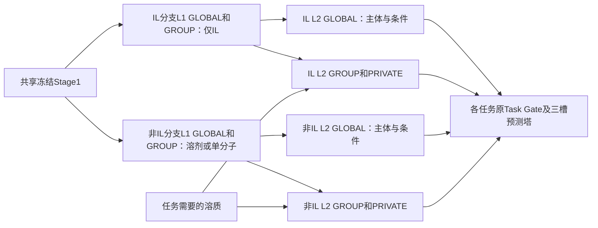

# ADR-0128：IL／非IL体系隔离专家消融S2

## 状态与范围

已接受（2026-11-14）。用户指定含IL体系的L1只编码IL，溶质在GROUP／PRIVATE L2接入；非IL体系使用另一套不共享的专家。用户另确认：两分支保留独立L2 GLOBAL且只读取主体；非IL的溶剂＋溶质在L1只编码溶剂；没有匹配预训练的IL solvation GROUP保持随机初始化，不借用非IL训练后权重。

S2扩展[ADR-0127](0127-partner-injection-and-typed-encoding-ablations.md)，不改现役Base、I1～I5、S1或[0124核心套件](0124-current-token-home-ablations.md)。Stage1共享冻结，learned1024／atom512／RDKit211、data/3407、训练seed42及折派生、G2_C01容量类别、007/032预算均不变。配置和新产物分别位于`configs/ablations/partner_injection_3407/S2/`、`outputs/ablations/partner_injection_3407/S2/`。正式运行由用户启动，见[手册](../system-experts-ablation-runbook.md)。

## 决定

`model.split_system_experts: true`仅搭配`partner_injection: group_private_l2`，禁止同时启用S1的`split_entity_encoders`。Stage2写在`home.model`，Stage3使用独立`ablation.variant: system_experts`。默认false省略序列化，旧配置、初始化、身份及前向行为保持不变。

按注册表声明的主体槽位分流：`(cation, anion)`为IL，其余合法单实体主体为非IL；不按单个实体的形式电荷、目标或原始字符串猜测是否存在IL。Stage2、Stage3和公开推理使用同一规则；带电溶质或带电单分子仍服从任务体系声明。

| 任务体系 | 分支 | L1主体 | GROUP／PRIVATE L2新增输入 |
|---|---|---|---|
| 纯IL | IL | 阳离子＋阴离子 | 无 |
| IL＋溶质 | IL | 阳离子＋阴离子 | 溶质 |
| 溶剂＋溶质 | 非IL | 溶剂 | 溶质 |
| hydration单分子 | 非IL | 溶质自身 | 无；不补造水实体 |

L1 GLOBAL和GROUP各有独立的IL／非IL投影、角色／位置编码、注意力及路由；L2 GLOBAL／GROUP、共享条件编码器、GROUP归一化也按体系隔离。只实例化各GROUP实际需要的分支；两个GLOBAL分支均保留。PRIVATE、Task Gate、任务归一化和Tower本来就逐任务独立，不重复分配不可达的任务副本。

各分支内沿用I2：L1不读取第三槽，GROUP／PRIVATE L2接收原GROUP投影、角色／位置和归一化后的溶质；PRIVATE使用主体GROUP路由加权汇聚。GLOBAL L2不接收溶质，门控结构输入及主体残差不读取溶质结构，保留三槽有效位。两分支不共享参数或storage，初始化从同一owner随机模板复制，在训练前完成；之后分别学习，不从已有训练后权重构建另一分支。

## 优化、迁移与身份

保留原GLOBAL／GROUP owner、当前真实batch样本加权分母、梯度裁剪、LR、scheduler及冻结日历，PRIVATE原始梯度与模拟隔离不变。分支参数独立不表示另设两套优化协议：同一owner的两个分支仍参与原owner级聚合及裁剪，不能宣称是两套完全独立优化的模型。无本分支数据时不执行其模块，参数`grad=None`，不施加AdamW衰减；Phase2同时冻结两个GLOBAL分支，Phase3同时冻结全部共享分支。

Stage2五模拟和原联合step完整保留：

- IL分支GLOBAL及thermophysical GROUP从四项纯IL模拟学习。
- 非IL分支GLOBAL及solvation GROUP从`simulation/transfer_organic`学习。
- Stage2无IL solvation任务，不实例化或宣称预训练该GROUP。

Stage3仅迁移同分支的GLOBAL、匹配GROUP和两模拟PRIVATE，禁止跨分支复制。IL solvation GROUP的L1／L2专家、路由、条件编码器及归一化在本折随机初始化并保持未迁移状态；其余无匹配来源的GROUP沿用既有随机初始化合同。

迁移允许缺失的集合仅为S2明确声明的IL solvation参数；非IL solvation、IL thermophysical及两个GLOBAL的完整张量集合仍须严格一致，额外张量、错误shape／dtype／hash继续拒载。Stage1来源SHA、数据、owner和完整状态hash不放宽。`resolved_training_plan.json`的`ablation.system_experts`绑定任务分支映射、共享参数分支计数及全部未预训练IL solvation参数名，初始模型状态hash也覆盖其随机权重。

体系路由、分支初始化、接入方式、未匹配迁移规则及原owner优化口径进入注意力／训练身份。同kind／format不表示兼容，禁止与I2、S1或其他变体跨模式恢复。现有Stage1及两阶段prepare只读复用，不改数据或SHA，不重编码。

## 容量与解释边界

生产维度、22实验＋两模拟的下游参数如下（meta设备实例化统计，不含冻结Stage1）：

| 变体 | Stage2参数 | Stage3参数 |
|---|---:|---:|
| I2 | 227,886,685 | 616,739,218 |
| S2 | 263,036,643 | 713,527,588 |

分别增加约15.4%及15.7%。Stage2只有GLOBAL增加副本，Stage3另增加IL／非IL的solvation GROUP副本。容量、计算量和预训练覆盖同时变化，S2对照I2检验整体体系隔离策略，不单独证明共享参数的因果作用，也不声称等参数／等计算量。显存、吞吐和GPU时间以正式日志为准，不从参数量推断固定运行时间。

新增1次Stage2及5个Stage3训练折，Stage1新增训练为零，不增加seed、不调预算、不早停。固定末轮，完整22任务五折验证，两个模拟独立报告；测试不驱动选择。

## 验证

复用小模型检查两个分支的storage及梯度隔离、无样本分支零更新（含Weight Decay）、IL／有机／单分子角色与mask、第三成分只影响GROUP／PRIVATE及预测、状态重载。迁移检查匹配来源逐tensor一致，随机IL solvation逐bit保留，缺失／多余／损坏来源拒载，跨模式拒载。

额外用现有临时主链定向验收S2的五模拟Stage2、22实验＋两模拟Stage3三阶段、完整轮恢复及独立评估，不增加默认重型链数量。代码修改运行完整pytest，受影响入口help、compileall、diff及文档链接检查；不启动正式prepare、训练或评估。
