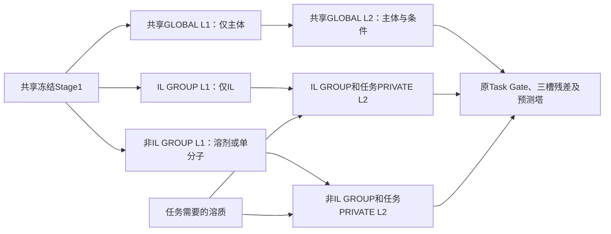

# ADR-0130：共享GLOBAL、体系隔离GROUP的S3消融

## 状态与目标

2026-11-17用户选定10轮Stage1的C0＋I2＋S3复跑。S3另增`configs/ablations/partner_injection_3407_10epochs/S3/stage{2,3}.yaml`，使用10轮编码器、C0新prepare与独立Stage2／Stage3输出；原共享结构、随机IL solvation初始化、seed和预算均不变。旧5轮S3配置和产物保留；命令见[10轮复跑手册](../partner-injection-ablation-runbook.md#10轮stage1c0i2s3复跑)。

已接受（2026-11-15，用户确认执行）。S3是I2与[体系隔离S2](0128-system-isolated-experts.md)之间的对照：保留跨体系GLOBAL，检验能否维持S2的solvation收益，同时改善非IL任务。当前S2与I2的22任务验证总分几乎持平；“拆分GLOBAL损失共享知识”只是待检验假设，不是既定结论。

本次只增加S3的配对Stage2/3配置，不改Base、I0～I5、S1或S2。共享冻结Stage1及现有prepare、data/3407、训练seed42与折派生、G2_C01每组专家容量、007/032预算、22实验＋两模拟均保持原合同。正式训练由用户启动，命令见[手册](../system-experts-ablation-runbook.md#s3共享global仅group按体系隔离)。

## 决定

在`split_system_experts: true`下增加`system_expert_scope: group`；缺省`global_group`保留S2行为且省略序列化。非缺省scope必须启用体系隔离，仍仅允许`partner_injection: group_private_l2`，与S1类型编码互斥。Stage3独立声明`ablation.variant: group_system_experts`，模型与变体须匹配。

| 参数／行为 | I2 | S2 | S3 |
|---|---|---|---|
| GLOBAL L1／L2、路由、条件编码 | 跨体系共享 | IL／非IL隔离 | 跨体系共享 |
| GROUP L1／L2、路由、条件编码及归一化 | 组内共享 | IL／非IL隔离 | IL／非IL隔离 |
| PRIVATE、Task Gate、Tower | 逐任务独立 | 逐任务独立 | 逐任务独立 |
| 溶质接入 | GROUP／PRIVATE L2 | GROUP／PRIVATE L2 | GROUP／PRIVATE L2 |
| IL solvation GROUP初始化 | 迁移原共享GROUP | 本折随机初始化 | 本折随机初始化 |

GLOBAL L1投影、角色／位置、注意力、路由及L2条件模块均为同一套参数；不按体系另建GLOBAL。主体与溶质、角色与mask、条件还原、GROUP投影汇聚给PRIVATE的规则均沿用I2／S2。按任务主体槽位分流，不按实体是否带电分流；hydration不补造水实体。

GROUP仅实例化实际任务需要的分支，训练前由本owner同一随机模板复制，storage不共享。GLOBAL初始化与I2逐参数一致；GROUP的分支初始化与S2一致。原owner、样本加权分母、裁剪、LR、调度和冻结日历不变；不按分支重新归一化。无样本GROUP分支保持`grad=None`，不受AdamW衰减。Phase2冻结共享GLOBAL，Phase3冻结全部共享参数；模拟继续只更新自身PRIVATE。

## 预训练、来源与兼容

Stage2四项IL模拟和非IL transfer_organic共同训练GLOBAL；thermophysical只训练IL GROUP，solvation只训练非IL GROUP。Stage3完整迁移共享GLOBAL、同体系匹配GROUP与两模拟PRIVATE；IL solvation GROUP在每折随机初始化，不复制非IL权重。无匹配的其他GROUP仍按原合同初始化。

S3必须新训练自己的Stage2 final，再训练Stage3五折；即使部分参数同形状也不能借用I2／S2来源。仅允许缺失明确列出的IL solvation参数，其他owner集合、shape、dtype、状态hash、来源SHA、数据身份与恢复检查不放宽。模型scope进入配置身份及注意力合同，Stage3的独立变体进入训练和评估身份，禁止跨模式恢复。

`resolved_training_plan.json`沿用`ablation.system_experts`记录体系映射、分支参数数目、136个未迁移IL solvation参数；S3另记录`shared_global_parameters`。旧S2审计字段及默认身份保持不变。新配置位于`configs/ablations/partner_injection_3407/S3/`，输出使用独立的`outputs/ablations/partner_injection_3407/S3/`；既有产物只读。

## 成本与解释边界

生产维度、22实验＋两模拟的下游参数（meta实例化，不含冻结Stage1）：

| 变体 | Stage2 | Stage3 |
|---|---:|---:|
| I2 | 227,886,685 | 616,739,218 |
| S2 | 263,036,643 | 713,527,588 |
| S3 | 227,886,685 | 678,377,630 |

S3共享GLOBAL为35,149,958参数；Stage3比I2增加约10.0%，比S2减少约4.9%。S3与S2比较同时改变GLOBAL共享、容量和预训练覆盖，不能单独宣称负迁移的因果作用。显存与运行时间读取正式日志，不从参数量外推。

不加入软路由、额外融合、容量补偿、训练seed或搜索变量。固定完整末轮，按22任务等权五折nMAE比较，并列solvation、transfer_organic、hydration、gas_solubility及其余任务；两个模拟独立报告。不按测试选方案。

## 验证

复用小模型测试S2／S3：配置往返与非法scope／跨模式拒载、GLOBAL初始化及跨体系梯度汇聚、GROUP独立storage／梯度／无样本零更新、仅GROUP／PRIVATE接收溶质、角色／mask、严格迁移与随机参数逐bit保留、状态重载及冻结。额外用已有临时主链定向运行S3的Stage2五模拟、Stage3三阶段、完整轮恢复与独立评估，不增加默认重型链数量。运行完整pytest、受影响入口help、compileall、diff及文档链接检查；不自动启动正式作业。
