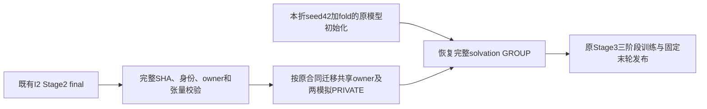

# ADR-0131：I2仅重置solvation GROUP初始化的R1消融

## 状态与问题

已接受（2026-11-15，用户确认执行）。I2迁移Stage2的有机转移solvation GROUP，而S2／S3的IL solvation GROUP从随机初始化开始；已有比较同时改变共享范围、容量和预训练覆盖。因此，不能将solvation收益全部归因于体系隔离。

R1保持[ADR-0127](0127-partner-injection-and-typed-encoding-ablations.md)的I2结构，只改变solvation GROUP的Stage3初始状态，检验此预训练初始化是否有利。它不检验取消全部Stage2的作用，也不改变Stage1、其他owner或数据。运行命令见[手册](../partner-injection-ablation-runbook.md#r1仅重置solvation-group的预训练初始化)。

## 决定

新增单份完整配置`configs/ablations/partner_injection_3407/R1/stage3.yaml`，声明`ablation.variant: random_solvation_group`。其余全部字段与I2相同，包括Stage2 final路径。GLOBAL／GROUP仍跨体系共享，溶质仍在GROUP／PRIVATE L2接入；模型参数集合、形状、owner和容量与I2相同，不拆分IL／非IL分支。

只恢复`GROUP:solvation`所属的L1／L2专家、L1路由、GROUP归一化和条件编码器。恢复值直接取自本折模型在迁移前的原始初始化，不重新调用初始化、不改变RNG、不以已训练权重构建随机分支。含IL和非IL的solvation任务继续使用同一套GROUP，PRIVATE、Task Gate、任务归一化及Tower按原I2策略保留。

GROUP归一化指原LayerNorm参数，不重新拟合scaler或目标统计；条件仍使用本折原训练统计，验证／测试统计不参与初始化。

共享GLOBAL、匹配thermophysical GROUP、两项模拟PRIVATE照常迁移；其他无Stage2来源的GROUP及实验PRIVATE保持I2同折初始值。Stage1永久冻结，learned1024／atom512／RDKit211、data/3407、训练seed42及原fold派生、22实验＋两模拟、007/032预算、loss、采样、batch、梯度聚合、裁剪、LR、冻结与完整轮恢复不变。

R1使用本折原随机初值，因此其与I2的差别是固定预算下完整solvation GROUP的初始化策略，不能自动推广为Stage2整体无益，或证明训练中任务共享必然发生负迁移。若未见收益，也不能排除训练预算、优化轨迹和任务差异的影响。

## 完整性与身份

Stage2原final及其配套清单先由原严格加载器完整校验；全部共享张量继续校验完整owner集合、shape、dtype及状态hash，随后才恢复随机GROUP。即使某个参数将被恢复，其来源损坏、缺失或额外张量也必须失败。源文件、元数据及SHA不改写，不提供任意owner排除开关。

实际迁移参数清单排除solvation GROUP；`stage2_pretraining.transferred_state_hash`只计算保留的共享迁移张量，另用`source_shared_state_hash`绑定完整共享来源。原来源文件SHA、完整模型及训练身份照常保留。

计划的`ablation.random_solvation_group`记录owner、完整参数名清单和`initial_state_hash`；原`initial_model_state_hash`覆盖最终初始化的完整模型。生产维度为136个重置参数名、61,638,412个参数。恢复／评估按本折重新构造并验证初始状态及训练身份，禁止与I2或其他变体交叉加载；相同kind／format及张量形状不表示身份兼容。

执行使用原Stage3公开入口，独立消融策略留在`ablations/`。Stage3的共享状态加载扩展点在默认Base及其他现有变体中仍调用原加载器，数值行为不变。模型、优化器和训练实现不增加新模式。

## 成本、运行与报告

只读复用I2的完整Stage2、冻结Stage1及匹配prepare；无新增Stage1／Stage2训练，无R1 Stage2配置或伪造的Stage2输出。仅新增Stage3五折，写入`outputs/ablations/partner_injection_3407/R1/stage3/`；不覆盖I2或其他输出。

R1下游Stage3为616,739,218参数，与I2相同，不含冻结Stage1；新训练成本只计Stage3，既有Stage2来源成本作为复用背景单列，不重复计为新增训练。完整产物按原规则归档4090。

主比较为R1对I2的22任务等权五折nMAE，同时报告solvation、transfer_organic、hydration、gas_solubility及其他任务的退化；S2／S3作辅助参照，两个模拟独立报告。固定末轮、无早停、无测试选模，不按任务拼装不同模型，不新增训练seed。

## 验证

临时小模型比较R1与I2：除solvation GROUP外逐tensor一致、owner／容量不变、随机GROUP逐bit保留、fold初值不同、RNG及来源不变；被恢复组的缺失／额外／错误形状／dtype／hash继续拒载。配置仅variant与I2不同，往返解析及错误模型组合拒载。

复用现有临时主链定向运行R1，检查两模拟PRIVATE保持迁移、实际迁移hash和重置清单、三阶段训练、完整轮恢复、最终重载与独立评估，不增加默认重型链。执行完整pytest、受影响入口help、compileall、diff及文档链接检查；不自动启动正式训练或评估。
